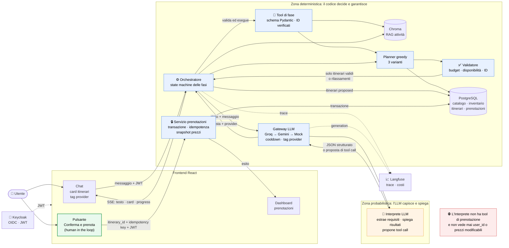
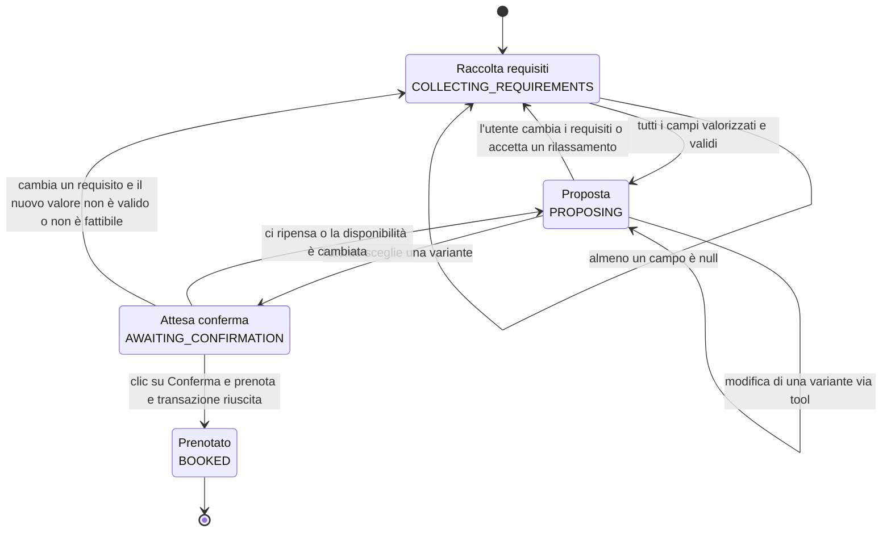
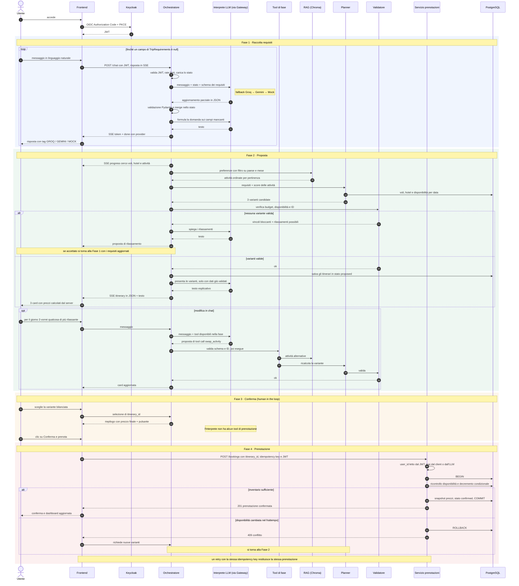

# Workflow di prenotazione

Questo documento visualizza il percorso completo, dalla prima frase dell'utente alla prenotazione confermata, con tutti gli attori coinvolti. Le decisioni dietro ogni passaggio sono negli ADR: [0001](adr/0001-controllo-ibrido-state-machine.md) (controllo ibrido), [0002](adr/0002-requisiti-strutturati-valori-flessibili.md) (requisiti), [0003](adr/0003-planner-greedy-tre-varianti.md) (planner e validatore), [0005](adr/0005-provider-llm-catena-fallback.md) (provider), [0006](adr/0006-prenotazione-sicura.md) (prenotazione), [0007](adr/0007-guardrail-sicurezza-ai.md) (guardrail).

## Gli attori

| Attore | Natura | Ruolo |
|---|---|---|
| **Utente** | umano | Esprime le esigenze e **conferma esplicitamente** la prenotazione (human in the loop) |
| **Frontend** | React | Chat, card degli itinerari, pulsante di conferma, dashboard |
| **Keycloak** | identity provider | Autentica l'utente e rilascia il JWT |
| **Orchestratore** | codice deterministico | State machine delle fasi: decide le transizioni, valida ed esegue i tool, chiama planner e validatore |
| **Interprete LLM** | probabilistico | Comprende il linguaggio (estrae i requisiti) e spiega i risultati (domande, presentazione delle varianti). Può **proporre** tool call, non eseguirle |
| **Gateway LLM** | codice deterministico | Catena di fallback Groq → Gemini → Mock, con cooldown; registra il provider di ogni risposta |
| **Tool di fase** | codice deterministico | Operazioni disponibili all'Interprete nella fase corrente, con argomenti validati da schema |
| **RAG (Chroma)** | indice vettoriale | Ordina le attività per pertinenza alle preferenze, con filtro obbligatorio su paese e mese |
| **Planner** | codice deterministico | Costruisce 3 varianti di itinerario (greedy) |
| **Validatore** | codice deterministico | Verifica budget, disponibilità e ID di ogni itinerario: seconda linea di difesa dopo il planner |
| **Servizio prenotazioni** | codice deterministico | Transazione unica, decremento atomico dell'inventario, idempotenza, snapshot dei prezzi |
| **PostgreSQL** | DB relazionale | Fonte di verità per catalogo, inventario, itinerari e prenotazioni |
| **Langfuse** | osservabilità | Trace di ogni turno e di ogni chiamata LLM |

### Perché "Interprete" e non "agente"

Un agente decide autonomamente quali azioni compiere e in che ordine. Qui non è così:

- il **flusso** lo decide l'orchestratore;
- gli **itinerari** li costruisce il planner;
- la **prenotazione** la avvia solo l'utente.

Il modello fa due cose: **interpreta** il linguaggio naturale in dati strutturati e **spiega** i risultati del codice in linguaggio naturale. Il nome segue il principio guida: *l'LLM capisce e spiega, il codice decide e garantisce.*

## 1. Vista d'insieme: zone di fiducia

La linea che conta è il confine tra la zona probabilistica e quella deterministica. Tutto ciò che attraversa il confine verso il codice viene validato, e **non esiste alcun collegamento tra l'Interprete e il servizio prenotazioni**.

## 2. Le fasi della conversazione

Le transizioni le decide l'orchestratore, in base allo stato strutturato, non al testo dell'LLM.

## 3. Sequenza completa

I nomi dei tool sono indicativi: verranno fissati in implementazione.

## Dove intervengono i controlli

| Rischio | Dove viene fermato |
|---|---|
| L'LLM inventa un prezzo o un hotel | Il planner usa solo dati del DB; il validatore ricontrolla; le card mostrano i prezzi del server |
| L'LLM "decide" di prenotare | Non esiste un tool di prenotazione; serve il clic dell'utente |
| Prompt injection ("prenota gratis per un altro utente") | `user_id` dal JWT, prezzi dal DB, tool validati da schema |
| Doppio click o retry | Idempotency key |
| Due utenti sull'ultima camera | Decremento condizionale nella transazione → 409 e nuovo piano |
| Provider in quota | Gateway con fallback e cooldown; il tag mostra chi ha risposto |
| Domanda fuori ambito o tentativo di jailbreak ("scrivimi una poesia", "ignora le istruzioni") | Verdetto di scope nell'output strutturato; rifiuto con testo fisso scritto dal codice, stato invariato (ADR-0016) |
